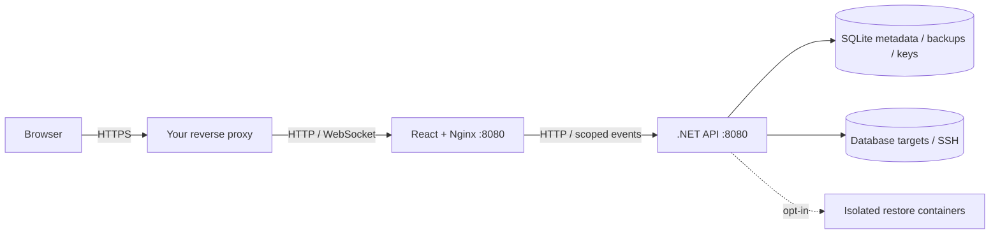

<div align="center">

# OctoBackup

**Database backups. One workspace. Your infrastructure.**

Self-hosted backup management with a .NET 10 API and React / TypeScript frontend.

[Quick start](#quick-start) · [Usage](#everyday-usage) · [Documentation](#documentation) · [Roadmap](#roadmap) · [Polski](docs/README_PL.md)

</div>

---

Manage database connections, access, scheduled exports and backup history from one responsive dashboard. Manual and scheduled backups share a persistent queue with cancellation, duplicate prevention and visible results.

| Database | Backup format | Requirements |
| --- | --- | --- |
| MySQL / MariaDB | SQL dump in ZIP | Compatible dump client and export grants |
| PostgreSQL | SQL dump in ZIP | `pg_dump` at least as new as the source major |
| SQL Server | Native `.bak` | Dedicated staging filesystem shared with the API |
| SQLite | Online `.sqlite` snapshot | Approved local source mount |

Optional global or individual passwords encrypt new backups. Authorized users can download files and request saved restore-test previews when the deployment runtime is enabled. A preview samples restored data; it does not prove a complete disaster recovery.

## Quick start

Run all commands from the repository root. Docker deployments require Docker Engine/Compose and Node.js for the initialization helper. Source development also requires the .NET 10 SDK selected by `global.json` and Node.js 22.12+.

### Docker behind your reverse proxy

```sh
node scripts/dev.mjs init
docker compose pull
docker compose up -d --wait
```

The private `.env` contains `ADMIN_EMAIL`, `ADMIN_PASSWORD` and a stable `CRYPTO_KEY`. Initialization preserves existing secrets. Add your public hostname to `ALLOWED_HOSTS` before starting, keeping
`localhost;127.0.0.1` for the container health probe. For example:
`ALLOWED_HOSTS=backups.example.com;localhost;127.0.0.1`.

Point your **HTTPS reverse proxy** at **http://127.0.0.1:8080** and enable WebSocket forwarding. Open your public HTTPS URL to sign in. Both application containers use HTTP internally; neither needs a certificate. The API stays private. Production cookies require HTTPS in the browser.

For **isolated private HTTP testing**, set `ALLOW_INSECURE_HTTP=true` in `.env`,
recreate the API, then open `http://<host>:<FRONTEND_PORT>`. This explicitly removes
Secure from session/CSRF cookies; keep it false for public HTTPS deployments.
CSRF validation remains required in both modes. [Login troubleshooting](docs/OPERATIONS.md#login-and-runtime-troubleshooting).

`FRONTEND_PORT` changes the host upstream port; existing `.env` files keep their previous value. If your proxy runs in Docker, attach it to the frontend network and use `frontend:8080`; see the [deployment guide](docs/OPERATIONS.md#reverse-proxy).

### Run from source

```sh
node scripts/dev.mjs init
dotnet restore OctoBackup.sln
npm ci --prefix Frontend
node scripts/dev.mjs
```

Open **http://127.0.0.1:5173**. The API runs on **http://127.0.0.1:5080**. Use `node scripts/dev.mjs api` or `node scripts/dev.mjs frontend` for separate terminals. Host-run exports require local dump tools.

For API-only development, `dotnet run --project Backend/src/Server.Api` creates private development settings on first startup. Initial credentials are in the ignored `appsettings.Local.json`; existing accounts are preserved.

Optional local database targets:

```sh
docker compose -f compose.dbs.yaml up -d --wait
```

These are backup targets; OctoBackup itself stores metadata in SQLite.

## Build and publish

Both Dockerfiles use the **repository root** as build context:

```sh
docker build -f Backend/Dockerfile -t lewan24/octobackup-api:latest .
docker build -f Frontend/Dockerfile -t lewan24/octobackup-web:latest .
docker compose up -d --wait
```

Use the same publishing command on **Linux and Windows** (Node.js required):

It builds both images before pushing, uses the repository root from any current
directory.

The images are Linux containers. Run them with Docker Engine on Linux or
[Docker Desktop in Linux-container mode on Windows](https://docs.docker.com/desktop/setup/install/windows-install/).
The selected Docker daemon determines the CPU architecture; publishing does not
create a multi-architecture manifest. Native Windows-container mode is unsupported.
Compose consumes these image tags; `docker compose up --build` alone does not build
the standard images.

For a console publish and frontend bundle:

```sh
dotnet publish Backend/src/Server.Api -c Release -o Backend/artifacts/publish
npm run build --prefix Frontend
```

A 401 from `POST /api/auth/Login` means the credentials/account were rejected;
a session-expired message applies to protected requests after login. Check the
API's `Sign-in rejected` reason and [login troubleshooting](docs/OPERATIONS.md#login-and-runtime-troubleshooting).
Bootstrap values create the first account only; changing them does not reset a
password in an existing volume.

## Everyday usage

1. Sign in as administrator. In **Application settings**, approve the exact database/SSH hostnames or IPs your deployment may contact. Review registration and account confirmation policies.
2. In **Servers**, create a connection and test it. Assign operators access where needed. Database TLS and verified SSH fingerprints are independent of the web reverse proxy.
3. Choose an individual backup password or enable global encryption in **Application settings**. Encryption starts disabled; keep recovery passwords outside the application.
4. Select **Queue backup**, or create a schedule. Follow the queue until it succeeds; acceptance is not completion. One export runs at a time.
5. Open **Backup history** to download an archive or choose **Test / preview**. Docker restore tests require deployment opt-in and preloaded compatible engine images.

Keep the complete `/data` volume, Data Protection keys and external `CRYPTO_KEY` in your recovery plan. Use one API replica per data directory. SQL Server needs shared staging; SQLite needs a narrow source mount. [Backup and recovery details](docs/BACKUPS.md).

## Architecture



| Path | Contents |
| --- | --- |
| `Backend/` | API, modules, tests, recovery tool and Dockerfile |
| `Frontend/` | React features, Nginx proxy, tests and Dockerfile |
| `deploy/` | Optional Compose overrides; merge after root `compose.yaml` |
| `scripts/` | Development launcher, image publishing and disposable smoke checks |
| `docs/` | Focused reference guides and editable architecture diagrams |

## Test

Run backend checks before browser tests; Windows can lock running API binaries.

```sh
dotnet build OctoBackup.sln
dotnet test Backend/tests/OctoBackup.Tests
npm test --prefix Frontend
npm run build --prefix Frontend
node Frontend/node_modules/@playwright/test/cli.js install chromium
npm run test:e2e --prefix Frontend
npm audit --prefix Frontend
dotnet list OctoBackup.sln package --vulnerable --include-transitive
```

Tests and deployment smoke checks use disposable data. Instructions for container and provider checks are in [operations](docs/OPERATIONS.md#validation).

## Documentation

| Guide | What you will find |
| --- | --- |
| [Operations](docs/OPERATIONS.md) | Deployment, reverse proxy, configuration reload, development and checks |
| [Database connections](docs/DATABASE_CONNECTIONS.md) | Dump clients, grants, networking and SQL Server staging |
| [Backups and recovery](docs/BACKUPS.md) | Encryption, source mounts, restore testing and offline decryption |
| [Architecture](docs/ARCHITECTURE.md) | Modules, data flow, queue contracts and editable draw.io diagrams |
| [Security](docs/SECURITY.md) | Trust boundaries, access controls and operational limits |
| [Interface](docs/DESIGN.md) | UI tokens, interaction patterns and accessibility |

## Roadmap

Suggestions for future work, rather than available features:

- Separate restore execution from the web API into a dedicated worker.
- Add MFA, verified email changes, invitations and password recovery.
- Add backup checksums, manifests, orphan-file reconciliation and configurable retries.
- Extend retention editing, server-side history filtering and timezone/DST scheduling.
- Provide an offline credential rekey tool and external key wrapping.
- Add object-storage destinations, remote SQLite transport and SQL Server retrieval adapters.
- Expand engine/version/large-schema restore coverage and accessibility CI.
- Generate API documentation and browser types; add English/Polish UI localization.

[MIT license](LICENSE)
