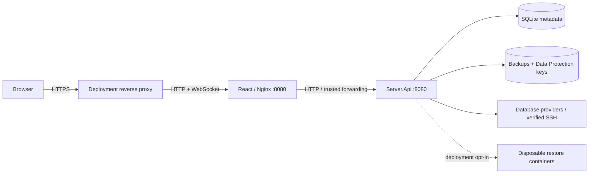
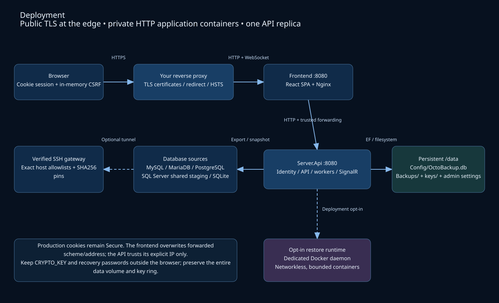

# Architecture

OctoBackup is a self-hosted database backup workspace for administrators and
operators. Administrators configure connections, network policies and user access;
operators run and schedule backups on assigned servers. The API is a .NET 10 modular
monolith. React/TypeScript/Vite provides the browser interface.

## Deployment and trust boundaries

The public edge owns TLS certificates, HTTPS redirects and HSTS. The frontend
serves the SPA and proxies `/api` and `/backuphub`. The private API accepts forwarded
scheme/address only from configured proxy IPs. It does not redirect HTTP or load a
web certificate. Production session/CSRF cookies default to Secure; isolated HTTP fixtures can explicitly opt out using `Security:AllowInsecureHttp`. Vite provides the
same-origin proxy during local HTTP Development.

[Editable draw.io project](diagrams/ServiceLogicProject.drawio) contains deployment,
module structure and backup lifecycle pages. The rendered deployment view below
matches the first page; regenerate it when changing the diagram.

## Repository and module boundaries

| Path | Responsibility |
| --- | --- |
| `Backend/src/Server.Api` | HTTP middleware, startup migrations, bootstrap, durable runtime policies and configuration reload |
| `Modules/AuthModule` | Identity accounts, login, registration and profile changes |
| `Modules/AdministrationModule` | User management, confirmation and blocking |
| `Modules/BackupModule` | Connections, SSH, assignments, schedules, export queue, history and restore tests |
| `Modules/CryptoModule` | New Data Protection credential writes and legacy credential reads |
| `Modules/Shared` | Storage, validation, authorization helpers and settings contracts |
| `Frontend/src/app` | Routes, authenticated shell, session and SignalR lifecycle |
| `Frontend/src/features` | Independent auth, dashboard, connections, schedules, queue, history and administration features |
| `Frontend/src/shared` | HTTP/CSRF transport, browser contracts and shared UI |
| `Backend/tests`, `Frontend/e2e` | Regression tests and disposable workflow/provider fixtures |

Core owns entities/provider adapters; Application coordinates use cases;
Infrastructure owns EF contexts; Api maps endpoints; Shared defines contracts.
Namespaces and existing EF migrations remain stable. There is no active Blazor host.
Frontend `app` composes features; shared code does not import features. Queue state
is passed into server views without a direct feature-to-feature dependency.

## Request and session flow

1. Identity issues an HttpOnly, SameSite Strict cookie after password/lockout checks.
2. React fetches `/api/auth/csrf`; the request token stays in memory and accompanies API mutations.
3. Endpoint authorization checks account, administrator role and resource assignments. UI visibility is presentation only.
4. Server-side SignalR sends payload-free invalidations to affected users/admins. Clients refetch authorized data and cannot broadcast.

Identity and backup EF contexts share `Config/OctoBackup.db`. Startup applies
retained additive migrations. Bootstrap creates an administrator only on an empty
user store. `Hosting:ServeFrontend` optionally enables embedded SPA hosting; the
production stack uses the separate frontend image.

## Persistent export queue

`BackupQueueService` handles admission, scoped listing/cancellation and schedule
acceptance. Manual backup requests return **202**, not completed backup data.
`BackupQueueProcessor` claims eligible SQLite rows and revalidates account,
assignment, target and destination policy. `BackupExecutor` exports/compresses.
One export runs at a time; run one API replica per data directory.

Target identity includes provider, canonical host, port, database and SSH endpoint.
A unique nullable active key prevents duplicates across equivalent connection rows;
different DNS aliases are not resolved into a common identity. Admission is capped
at 1,000 active requests and list pages at 100 rows.

Due schedules use the same queue. Occurrence advancement and admission commit
together; matching due occurrences on one connection coalesce. Cancellation skips
an accepted occurrence and failures require explicit retry. Invalid destinations
stay due for repair. Queue eligibility is not a guaranteed start time.

Waiting cancellation releases the active key immediately; running cancellation
keeps it until the worker acknowledges stopping. Successful metadata publication
and terminal state commit atomically, arbitrating cancellation races. Retention
follows a durable replacement. Remove hides audit rows without deleting backups.
Queued work survives restart; running/stopping work becomes Interrupted. Hard
crashes can leave orphan files requiring inspection.

## Providers and artifact lifecycle

- MySQL/MariaDB and PostgreSQL use external dump clients, then ZIP compression.
- SQL Server creates a native COPY_ONLY/CHECKSUM `.bak` on its host. Dedicated shared staging lets the API copy it privately and remove staging plaintext.
- SQLite uses the online snapshot API from an approved narrow source mount.
- Publication encrypts new files when an individual password or enabled global policy applies. Historical versions remain available.
- A separate durable restore queue authenticates/decrypts artifacts, uses compatible deployment-owned images, saves bounded previews and removes containers. SQLite validates snapshots read-only in-process.

Restore previews contain sampled plaintext in metadata. They prove neither full
source equality nor application recovery. [Provider configuration](DATABASE_CONNECTIONS.md)
and [encryption/restore details](BACKUPS.md) describe formats and operational limits.

## Storage and configuration

The data root contains `Config/OctoBackup.db`, `Backups/`, `keys/` and persisted
administrator settings. Compose uses `/data`; Development uses `Backend/data`.
`OCTOBACKUP_DATA` takes precedence over `Storage:DataDirectory`. Preserve the whole
store, external `CRYPTO_KEY` and recovery passwords.

New database/SSH credentials and versioned backup keys use Data Protection. Legacy
GCM/CBC credentials remain readable with `CRYPTO_KEY`. Global backup encryption
starts disabled; individual passwords apply independently. Password changes affect
future artifacts only.

The host watches runtime JSON and retains last-valid snapshots on malformed saves.
Startup storage/keys/HTTP/proxy/session values stay frozen. Environment/CLI values
retain precedence; saved administrator policies supersede deployment defaults.
Active restore scopes capture their settings through cleanup.
[Configuration precedence and reload](OPERATIONS.md#configuration).

## API contracts

| Route | Contract |
| --- | --- |
| `GET /api/health` | Minimal anonymous liveness after initialization |
| `GET /api/auth/csrf` | Initialize CSRF protection |
| `POST /api/backups/PerformBackup` | Server GUID → 202 + request DTO |
| `GET /api/backup-queue?offset=0&limit=25` | Scoped request page and worker summary |
| `POST /api/backup-queue/Cancel` or `/Delete` | Request GUID → 204 |
| `POST /api/backups/PerformSchedulesBackup` | Administrator admission → 202 + count |
| `POST /api/backups/TestBackup` | Backup GUID → 202 + durable report |
| `GET /api/backups/RestoreReport?id=…` | Latest authorized report or JSON null |

Mutations require session and CSRF. Unknown API paths return 404, never SPA HTML.
Legacy secondary-token endpoints and anonymous container execution are absent.
Unsupported backup deletion returns 501. Browser contracts live in
`Frontend/src/shared/types.ts`; backend Shared projects provide server contracts.
Generated OpenAPI/type synchronization remains proposed work in the root README.
